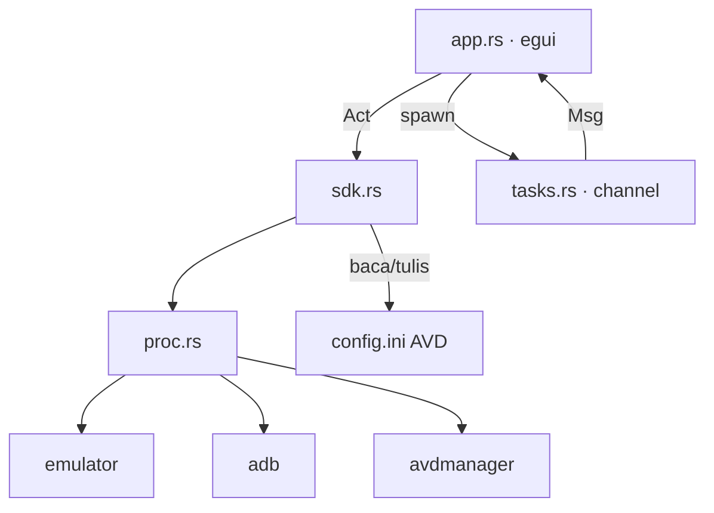

# ManDra, Management Android Emulator

GUI pengganti jendela *Device Manager* di Android Studio. Satu file `.exe`, tanpa install,
tanpa JVM sendiri: semua pekerjaan dilakukan lewat `emulator`, `adb`, dan `avdmanager`
yang sudah ada di SDK-mu.

Asumsi: Android Studio + JDK 17 sudah terpasang, jadi SDK, system image, dan driver
sudah beres. Tool ini tidak mengunduh apa pun.

## Build

```powershell
# toolchain MSVC (butuh Visual Studio Build Tools)
cargo build --release

# atau toolchain GNU
rustup run stable-x86_64-pc-windows-gnu cargo build --release
```

Hasil: `target/<triple>/release/devmgr.exe` (~5 MB, statis selain DLL sistem).

Di mesin ini toolchain MSVC tidak terpasang dan TDM-GCC tidak punya `libgcc_eh.a`.
Supaya build GNU tetap jalan, buat stub kosong sekali:

```powershell
New-Item -ItemType Directory -Force .linkshim
C:\TDM-GCC-64\bin\ar.exe rcs .linkshim\libgcc_eh.a
$env:RUSTFLAGS = "-C link-arg=-L$((Resolve-Path .linkshim).Path)"
```

## Yang bisa dilakukan

| Area | Aksi |
| --- | --- |
| AVD | list, start, cold boot, wipe data, stop, delete, edit config, tambah baru dengan device frame on/off dan custom skin (.zip atau folder) lewat Browse |
| Device | daftar device fisik + emulator (`adb devices -l`), detail model/product/transport |
| Screen | capture sekali atau live, simpan PNG ke `devmgr-out/`, dan rekam layar ke MP4 (`adb shell screenrecord`, maks. 3 menit) |
| Logcat | tail dengan filter teks, jumlah baris, mode live, clear |
| Install | `adb install` (opsional `-r`), pilih file atau drag & drop `.apk` ke jendela |
| Ports | `adb forward` / `adb reverse`, add / remove / list |
| Snapshots | daftar snapshot AVD lewat `emulator -snapshot-list` |
| WSA | install / start / stop / restart VM, `adb connect 127.0.0.1:58526`, daftar & launch aplikasi, browse file Android |

Refresh device berjalan otomatis tiap 2 detik; tab Screen/Logcat punya interval live
sendiri (Settings → Live interval).

## WSA

Windows Subsystem for Android tampil sebagai target sendiri di sidebar. Bedanya dengan
AVD: serial `127.0.0.1:58526` tidak pernah muncul di `adb devices` sampai ada yang
menjalankan `adb connect`, jadi panel melakukannya sendiri setelah VM hidup.

Lokasi install dicari berurutan: `wsa_root` di settings, path `WsaService` dari
`sc qc WsaService`, lalu `%USERPROFILE%\WSA`. Yang dipakai adalah `WsaClient\WsaClient.exe`
dari folder itu, jadi install MagiskOnWSALocal maupun paket Store sama-sama jalan.

Folder itu juga yang dipakai tombol **Set folder…**, dan nilainya langsung disimpan ke
`settings.ini` supaya tidak perlu diisi ulang.

Status pemasangan dibaca dari Windows (`Get-AppxPackage *WindowsSubsystemForAndroid*`),
jadi tombol menyesuaikan keadaan:

| Kondisi | Tombol |
| --- | --- |
| folder belum diset | `Set folder…` |
| folder ada, paket belum terdaftar | `Install` |
| paket terdaftar, VM mati | `Start`, `Connect only` |
| VM hidup | `Stop`, `Restart` |

`Install` menjalankan `Add-AppxPackage -Register AppxManifest.xml` di dalam folder
(layout MagiskOnWSALocal), atau `Add-AppxPackage -Path` bila folder hanya berisi
`.msixbundle`. Sesudah terdaftar, Start baru diaktifkan.

`Open Folder` membuka file manager Android di dalam panel — bukan folder install di
Windows. Isinya `adb shell ls -lAp` mulai dari `/sdcard`, bisa naik direktori atau
mengetik path langsung, dan `Simpan` menarik file ke `devmgr-out/` lalu membuka
foldernya. Folder install Windows punya tombol sendiri: `Buka install dir`.

Tombol di tab Overview:

| Aksi | Perintah |
| --- | --- |
| Install | `Add-AppxPackage -Register AppxManifest.xml` (atau `-Path` untuk `.msixbundle`) |
| Start | aktivasi `wsa://systemsettings`, lalu tunggu port 58526 dan `adb connect` |
| Stop | `shell reboot -p`, tunggu port tutup, lalu `sc stop WsaService` dan bunuh `WsaClient`/`WsaSettings` |
| Restart | `adb -s 127.0.0.1:58526 shell reboot` |
| Open Folder | `adb shell ls -lAp <path>` (browser file Android, mulai `/sdcard`) |
| Buka install dir | buka folder install WSA di Explorer |
| Launch app | `monkey -p <paket> -c android.intent.category.LAUNCHER 1` |
| Simpan | `adb pull <file>` ke `devmgr-out/` |

Stop butuh langkah tambahan karena `reboot -p` hanya mematikan Android: `vmmemWSA`
(±1,7 GB) dan `WsaClient` biasanya masih hidup sesudahnya, jadi RAM tidak pernah
kembali. Services + proses sisa dibereskan supaya Start berikutnya benar-benar cold
boot. Siklus Stop lalu Start terukur: VM hilang total, kembali siap dalam ±10 detik.

Start **tidak** boleh memanggil `WsaClient.exe` langsung. Yang terjadi pada mesin ini:

| Cara start | Hasil |
| --- | --- |
| `CreateProcess WsaClient.exe`, cwd sembarang | `gfxstream_backend.dll was not found`, proses mati diam-diam |
| `CreateProcess WsaClient.exe`, cwd = folder install | exit `0xC0000409` (ucrtbase BEX64, unhandled abort) |
| aktivasi `wsa://` lewat shell | boot normal, adb siap ~10 detik |

`WsaClient.exe` butuh identitas paket yang hanya diberikan jalur aktivasi shell.
Implementasinya memakai `rundll32 url.dll,FileProtocolHandler wsa://systemsettings`,
karena argumen kosong yang dibutuhkan `cmd /c start` ditolak `std::process::Command`.

`reboot -p` dipakai sebagai langkah pertama Stop karena `/shutdown` milik WsaClient
hanya bereaksi kalau jendela UI-nya aktif. Perlu diingat: `reboot -p` menghentikan
Android tetapi kadang meninggalkan `vmmemWSA` dan proses `WsaClient` menggantung;
Start berikutnya tetap berhasil karena jalur aktivasi dipakai ulang.

Probe port berjalan di worker thread dengan batas 40 ms dan hasilnya di-cache. Jangan
pindahkan ke jalur render: TCP connect ke port tertutup membakar seluruh waktu retry
Windows (terukur ~2 detik per percobaan), dan UI akan tersendat tiap frame.

## Konfigurasi

`%APPDATA%\devmgr\settings.ini`

```ini
sdk_override=            # kosong = auto-deteksi ANDROID_SDK_ROOT / ANDROID_HOME / %LOCALAPPDATA%\Android\Sdk
extra_args=-gpu host     # argumen tambahan untuk emulator
live_ms=900              # interval live screenshot/logcat
wsa_root=                # kosong = auto-deteksi folder install WSA
wsa_autostart=1          # 1 = adb connect saat panel dibuka
```

Deteksi SDK memakai urutan: `ANDROID_SDK_ROOT`, `ANDROID_HOME`, `%LOCALAPPDATA%\Android\Sdk`,
`~/Android/Sdk`. AVD dibaca dari `ANDROID_AVD_HOME`, `ANDROID_USER_HOME\avd`, lalu `~/.android/avd`.

`avdmanager` (untuk create/delete AVD) butuh JDK. Kalau `java` tidak ada di PATH,
set `JAVA_HOME`.

## Struktur



- `app.rs` — seluruh UI: sidebar AVD/device, tab, modal, log aktivitas.
- `sdk.rs` — deteksi SDK, parser `config.ini`, `adb devices -l`, system image, device defs.
- `proc.rs` — pembungkus `Command`. `cmd()` untuk tool singkat (`CREATE_NO_WINDOW`,
  tidak ada console berkedip); `detached()` untuk emulator, karena `emulator.exe`
  adalah binary CONSOLE-subsystem dan tanpa flag itu Windows memberinya console
  window baru yang terlihat.
- `tasks.rs` — channel `Msg`; setiap pekerjaan berat jalan di thread sendiri, UI tidak
  pernah memblokir.
- `settings.rs` — baca/tulis `settings.ini`.
- `wsa.rs` — deteksi + pemasangan WSA (`Get-AppxPackage` / `Add-AppxPackage`),
  start/stop lewat `WsaClient.exe`, probe port ADB, daftar aplikasi, dan browser file
  guest (`ls`, `pull`).

## Catatan performa

Semua panggilan SDK (`adb`, `avdmanager`, `emulator`) berjalan di worker thread, bukan di
UI thread. Ini penting karena biayanya besar:

| Panggilan | Biaya terukur |
| --- | --- |
| `avdmanager list device` | ~4,2 s (start JVM) |
| `adb emu avd name` (per emulator) | ~2,3 s |
| `adb devices -l` | ~0,2 s |

`avdmanager list device` hanya dijalankan sekali per sesi (di-cache), dan tiap worker
punya penjaga `pending_*` supaya tugas lambat tidak menumpuk. Panel Activity menampilkan
`frame p50/p99` untuk memantau apakah UI benar-benar mulus.

Semua perintah dibaca ulang dari disk setiap refresh, jadi perubahan dari Android Studio
langsung terlihat tanpa restart.
