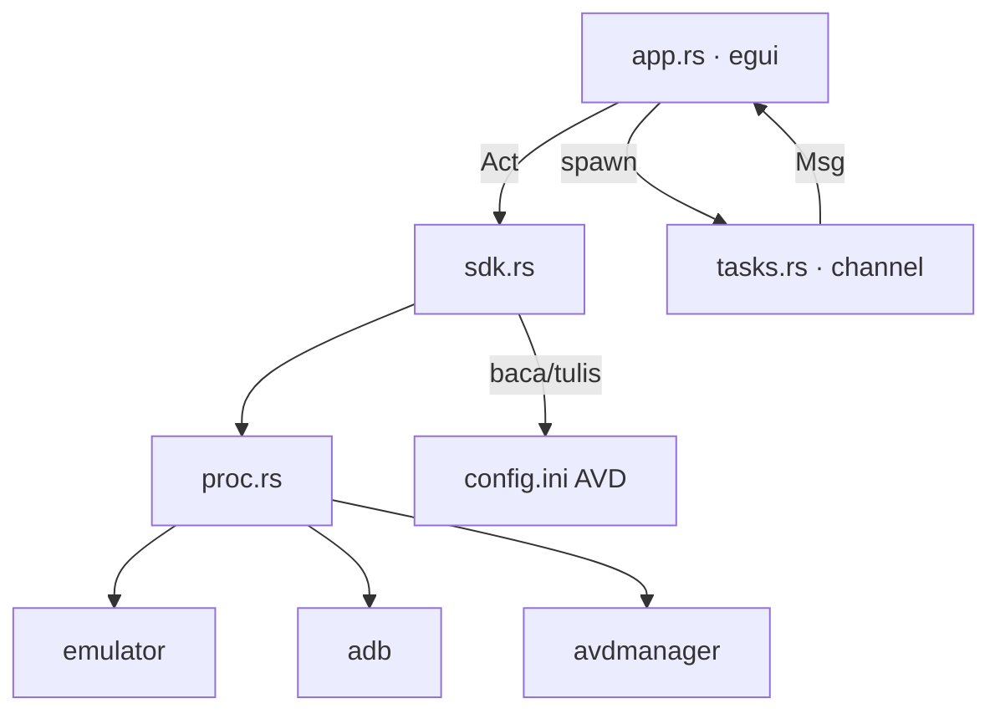

# ManDra, Management Android Emulator

GUI pengganti jendela *Device Manager* di Android Studio. Satu file `.exe`, tanpa install,
tanpa JVM sendiri: semua pekerjaan dilakukan lewat `emulator`, `adb`, dan `avdmanager`
yang sudah ada di SDK-mu.

Asumsi: Android Studio + JDK 17 sudah terpasang, jadi SDK, system image, dan driver
sudah beres. Tool ini tidak mengunduh apa pun.

## Build

```powershell
# toolchain MSVC (butuh Visual Studio Build Tools)
cargo build --release

# atau toolchain GNU
rustup run stable-x86_64-pc-windows-gnu cargo build --release
```

Hasil: `target/<triple>/release/devmgr.exe` (~5 MB, statis selain DLL sistem).

Di mesin ini toolchain MSVC tidak terpasang dan TDM-GCC tidak punya `libgcc_eh.a`.
Supaya build GNU tetap jalan, buat stub kosong sekali:

```powershell
New-Item -ItemType Directory -Force .linkshim
C:\TDM-GCC-64\bin\ar.exe rcs .linkshim\libgcc_eh.a
$env:RUSTFLAGS = "-C link-arg=-L$((Resolve-Path .linkshim).Path)"
```

## Yang bisa dilakukan

| Area | Aksi |
| --- | --- |
| AVD | list, start, cold boot, wipe data, stop, delete, edit config, tambah baru dengan device frame on/off dan custom skin (.zip atau folder) lewat Browse |
| Device | daftar device fisik + emulator (`adb devices -l`), detail model/product/transport |
| Screen | capture sekali atau live, simpan PNG ke `devmgr-out/` |
| Logcat | tail dengan filter teks, jumlah baris, mode live, clear |
| Install | `adb install` (opsional `-r`), pilih file atau drag & drop `.apk` ke jendela |
| Ports | `adb forward` / `adb reverse`, add / remove / list |
| Snapshots | daftar snapshot AVD lewat `emulator -snapshot-list` |

Refresh device berjalan otomatis tiap 2 detik; tab Screen/Logcat punya interval live
sendiri (Settings → Live interval).

## Konfigurasi

`%APPDATA%\devmgr\settings.ini`

```ini
sdk_override=            # kosong = auto-deteksi ANDROID_SDK_ROOT / ANDROID_HOME / %LOCALAPPDATA%\Android\Sdk
extra_args=-gpu host     # argumen tambahan untuk emulator
live_ms=900              # interval live screenshot/logcat
```

Deteksi SDK memakai urutan: `ANDROID_SDK_ROOT`, `ANDROID_HOME`, `%LOCALAPPDATA%\Android\Sdk`,
`~/Android/Sdk`. AVD dibaca dari `ANDROID_AVD_HOME`, `ANDROID_USER_HOME\avd`, lalu `~/.android/avd`.

`avdmanager` (untuk create/delete AVD) butuh JDK. Kalau `java` tidak ada di PATH,
set `JAVA_HOME`.

## Struktur



- `app.rs` — seluruh UI: sidebar AVD/device, tab, modal, log aktivitas.
- `sdk.rs` — deteksi SDK, parser `config.ini`, `adb devices -l`, system image, device defs.
- `proc.rs` — pembungkus `Command`. `cmd()` untuk tool singkat (`CREATE_NO_WINDOW`,
  tidak ada console berkedip); `detached()` untuk emulator, karena `emulator.exe`
  adalah binary CONSOLE-subsystem dan tanpa flag itu Windows memberinya console
  window baru yang terlihat.
- `tasks.rs` — channel `Msg`; setiap pekerjaan berat jalan di thread sendiri, UI tidak
  pernah memblokir.
- `settings.rs` — baca/tulis `settings.ini`.

## Catatan performa

Semua panggilan SDK (`adb`, `avdmanager`, `emulator`) berjalan di worker thread, bukan di
UI thread. Ini penting karena biayanya besar:

| Panggilan | Biaya terukur |
| --- | --- |
| `avdmanager list device` | ~4,2 s (start JVM) |
| `adb emu avd name` (per emulator) | ~2,3 s |
| `adb devices -l` | ~0,2 s |

`avdmanager list device` hanya dijalankan sekali per sesi (di-cache), dan tiap worker
punya penjaga `pending_*` supaya tugas lambat tidak menumpuk. Panel Activity menampilkan
`frame p50/p99` untuk memantau apakah UI benar-benar mulus.

Semua perintah dibaca ulang dari disk setiap refresh, jadi perubahan dari Android Studio
langsung terlihat tanpa restart.
